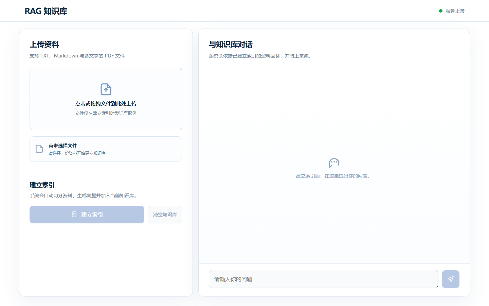
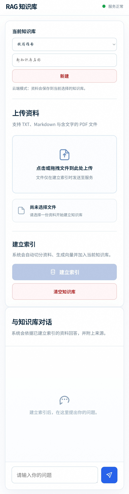
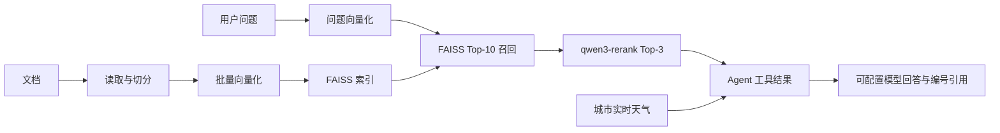

# RAG 知识库问答系统

一个可公开体验的 RAG（检索增强生成）知识库问答应用。公开 Demo 固定使用不含敏感信息的样本知识库，访客可直接提问但不能修改数据；本地或非公开环境支持上传资料并建立索引。


## 在线体验

- 在线 Demo：[rag-knowledge-base-zhqq.onrender.com](https://rag-knowledge-base-zhqq.onrender.com)
- 健康检查：[在线状态](https://rag-knowledge-base-zhqq.onrender.com/health)

> Render 免费服务闲置后会休眠，首次重新访问可能需要等待约一分钟启动。

## 界面预览

桌面端支持上传 TXT、Markdown 和含文字的 PDF，建立索引后即可在右侧对话区域提问并查看来源。



手机端会自动调整为纵向布局。



## 功能

- 上传并读取 TXT、Markdown 与含文字的 PDF 文档。
- 文本自动切分：默认每段 800 字符、重叠 100 字符。
- 调用阿里云百炼兼容接口生成文本向量。
- 使用 FAISS 进行余弦相似度检索。
- FAISS 先召回最多 10 条候选，再调用 `qwen3-rerank` 精排最多 3 条资料。
- Agent 通过工具调用决定何时检索知识库、读取来源或计算表达式，再生成中文回答。
- 配置和风天气后，Agent 可查询城市或区县的实时天气；无需先建立知识库索引。
- 对话模型可配置为百炼 Qwen 或 DeepSeek；知识库事实以 `[1]` 至 `[3]` 标注来源。
- 来源卡片显示文件名、从 1 开始的段落编号、相关度与命中原文摘要。
- 索引会保存在本地，服务重启时自动恢复。
- 非公开环境支持建立索引、问答和清空知识库；公开 Demo 为只读模式。
- 配置 Supabase 后，支持创建、切换多个云端知识库，并持久保存资料与向量。

## 工作流程



## Agent 工作方式

项目使用单 Agent 架构，不把多个提示词包装成“多智能体”。Agent 每次最多进行 3 轮工具调用，工具参数由服务端再次校验：

| 工具 | 作用 | 安全边界 |
| --- | --- | --- |
| `search_knowledge` | 检索知识库并对结果重排序 | 最多返回 3 条来源 |
| `read_source` | 读取本轮已经检索到的某条来源 | 不能读取未命中的资料 |
| `calculate` | 计算简单四则运算 | 只解析数字、括号和 `+ - * /`，不执行代码 |
| `get_weather` | 查询城市或区县的实时天气 | 仅查询当前天气，地点长度不超过 80 字；需配置和风天气 |

以后接入新工具时，按以下顺序操作：定义清晰的输入参数 → 编写只完成一件事的 Python 函数 → 在 `app/agent_service.py` 注册工具描述和服务端参数校验 → 在 `app/main.py` 提供数据或业务回调 → 为正常和异常输入补充离线测试。不要让模型直接访问数据库、文件系统或密钥。

天气工具提供了一个完整例子：`app/agent_service.py` 告诉模型工具名称与参数，并再次检查地点；`app/main.py` 把工具接到服务端；`app/weather_client.py` 先用城市搜索取得经纬度，再请求实时天气。模型只看到返回的天气数据，API Key 只在服务端环境变量中。网页会显示“天气服务由和风天气驱动”的来源链接。

网页会在当前浏览器会话中保留最近 3 轮问答，用于理解连续追问；刷新页面、切换、清空或删除知识库后会自动清除。这些短期上下文不会写入 Supabase，也不提供跨设备的对话记录。

## 技术栈

- 后端：Python、FastAPI、Uvicorn
- 检索：FAISS、NumPy
- 云端模型：可切换的 OpenAI 兼容对话模型（Qwen / DeepSeek）、百炼 `text-embedding-v2`、`qwen3-rerank`
- 前端：原生 HTML、CSS、JavaScript
- 部署：Docker、Render、GitHub

## 本地运行

### 1. 克隆项目并创建虚拟环境

```powershell
git clone https://github.com/zh-qq/rag-knowledge-base.git
cd rag-knowledge-base
python -m venv .venv
.\.venv\Scripts\Activate.ps1
pip install -r requirements.txt
```

### 2. 配置云端模型

将 `.env.example` 复制为 `.env`，然后填写以下值：

```text
# 对话模型：可选择百炼或 DeepSeek。
CHAT_API_KEY=<你的对话模型 API Key>
CHAT_BASE_URL=<你的对话模型兼容接口地址>
CHAT_MODEL=qwen-plus

# 向量化与重排序：当前使用百炼。
DASHSCOPE_API_KEY=<你的百炼 API Key>
DASHSCOPE_BASE_URL=<你的百炼兼容接口地址>
EMBEDDING_MODEL=text-embedding-v2
DASHSCOPE_RERANK_BASE_URL=https://<你的业务空间>.cn-beijing.maas.aliyuncs.com/compatible-api/v1
RERANK_MODEL=qwen3-rerank
```

`.env` 已被 Git 忽略，禁止提交或分享。

#### 切换对话模型

对话模型通过 `CHAT_API_KEY`、`CHAT_BASE_URL` 与 `CHAT_MODEL` 配置；向量化和重排序仍使用百炼，因此切换对话模型不会影响现有 FAISS、Embedding 和 Rerank 流程。

使用百炼 Qwen 时，填写：

```text
CHAT_API_KEY=<你的百炼 API Key>
CHAT_BASE_URL=https://<你的业务空间>.cn-beijing.maas.aliyuncs.com/compatible-mode/v1
CHAT_MODEL=qwen-plus
```

使用 DeepSeek 时，填写：

```text
CHAT_API_KEY=<你的 DeepSeek API Key>
CHAT_BASE_URL=https://api.deepseek.com
CHAT_MODEL=deepseek-flash
```

旧版 `DASHSCOPE_API_KEY` 与 `DASHSCOPE_BASE_URL` 仍可作为对话模型配置的兼容回退。新项目应优先使用 `CHAT_*` 变量。切换后重启本地服务；Render 则在 Environment 页面更新同名变量并等待自动部署。

#### 启用实时天气工具

1. 登录[和风天气官方控制台](https://console.qweather.com/)，创建项目，并在项目内添加 **API KEY** 凭据。只需为当前项目创建一个 Key。
2. 在控制台“设置”中找到自己的 **API Host**。这是专属域名；复制时在前面加上 `https://`，不要使用旧的公共 API 地址。
3. 在项目根目录的 `.env` 中添加以下两行，把占位内容换成控制台显示的值；不要把真实 Key 发到聊天里：

```text
QWEATHER_API_KEY=<你的 API Key>
QWEATHER_API_HOST=https://<你的专属 API Host>
```

4. 重启本地服务，打开 `http://127.0.0.1:8000`，提问“黄山市现在天气怎么样？”。页面应显示天气回答、`查询实时天气`执行记录和“天气服务由和风天气驱动”链接。若尚未建立知识库索引，天气问题仍可发送。
5. 本地验证成功后，若要让公网 Demo 也能查天气，再到 Render 服务的 **Environment → Edit** 添加相同的两项变量并保存。仓库中的 `render.yaml` 只声明变量名，不包含真实值。

此工具仅支持**实时天气**，不能查询明天或未来几天的预报。一次提问通常会先搜索城市、再查询天气，产生两次 API 请求。和风天气当前按月累计计费，天气与 GeoAPI 所在价格组前 5 万次请求单价为 0 元，超出后会计费；公开开放前请在控制台核对最新价格与用量。未设置天气变量时，知识库检索、计算与问答仍可使用；天气问题会收到配置错误提示。

### 3. 可选：启用 Supabase 云端知识库

1. 在 Supabase 新建免费项目。
2. 打开 SQL Editor，执行仓库中的 [`supabase/schema.sql`](supabase/schema.sql)。
3. 在 `.env` 中补充下列服务端变量：

```text
SUPABASE_URL=https://<你的项目标识>.supabase.co
SUPABASE_SECRET_KEY=<你的 Supabase Secret Key>
```

`SUPABASE_SECRET_KEY` 只能放在 FastAPI 与 Render 的环境变量中，绝不能提交到 GitHub 或写进浏览器代码。未配置这两个变量时，项目仍使用本地单知识库模式。

### 4. 公开 Demo 配置

公开部署前，先在非公开模式下创建名为 `公开演示知识库` 的云端知识库，并导入仓库中的 [`demo/campus-guide.md`](demo/campus-guide.md)。确认可正常问答后，在 Render 环境变量中设置：

```text
PUBLIC_DEMO_MODE=true
PUBLIC_DEMO_KNOWLEDGE_BASE_NAME=公开演示知识库
MAX_UPLOAD_BYTES=2097152
MAX_CHUNK_COUNT=200
MAX_QUESTION_LENGTH=1000
EMBEDDING_BATCH_SIZE=32
```

公开模式下，服务器会拒绝创建、切换、上传、预览、切分、索引和清空接口，访客无法修改 Supabase 中的公共资料。

启用新版本前，还必须在同一个 Supabase 项目的 SQL Editor 中执行一次 [`supabase/demo-quota.sql`](supabase/demo-quota.sql)。这会新增独立的每日用量表与原子计数函数，不修改现有知识库表。公开 Demo 全体访客共享北京时间每天 **100 次问答/检索**和 **100 次天气工具调用**；天气问题同时占用问答额度。额度用尽返回 429，用量数据库不可用时返回 503 并停止继续调用收费服务。本地非公开模式不受限制。由于目前没有用户登录，这不是按访客分配的额度，也不是和风天气账号级硬限额；其他项目使用同一账号产生的请求仍需在官方控制台查看。

### 5. 启动服务

```powershell
uvicorn app.main:app --reload
```

打开 `http://127.0.0.1:8000`，上传资料后即可开始提问。

## API 概览

| 接口 | 用途 |
| --- | --- |
| `GET /health` | 服务健康检查 |
| `GET /knowledge-bases` | 列出可访问知识库；公开模式仅返回样本库 |
| `POST /knowledge-bases` | 创建云端知识库；公开模式禁用 |
| `POST /knowledge-bases/{id}/select` | 切换知识库；公开模式禁用 |
| `DELETE /knowledge-bases/{id}` | 删除当前云端知识库及全部资料；公开演示知识库受保护 |
| `POST /documents/preview` | 预览上传文档 |
| `POST /documents/chunks` | 查看文本切分结果 |
| `POST /documents/index` | 上传并建立知识库索引 |
| `GET /search?query=...&knowledge_base_id=...` | 检索相关文本段落；知识库 ID 可省略 |
| `POST /ask` | 由 Agent 调用工具完成问答，返回编号来源与工具调用记录 |
| `DELETE /knowledge-base` | 清空当前知识库 |

## 检索效果评估

评测集位于 [`evals/retrieval-cases.json`](evals/retrieval-cases.json)，包含 10 份公开校园指南资料、25 条有答案问题和 5 条无答案问题。评测会比较“仅 FAISS”和“FAISS + Rerank”，并输出：

- `Recall@3`：预期来源出现在前 3 个结果中的问题比例。
- `MRR@3`：预期来源排名的平均倒数，越接近 1 表示越靠前。
- 逐题的 FAISS 与 Rerank 命中排名；无答案题单独列出，不计入两项指标分母。

运行真实评测会调用百炼向量与重排序接口，但不会写入本地或 Supabase 知识库：

```powershell
.\.venv\Scripts\python.exe -m app.retrieval_evaluation
```

真实评测结果会在首次配置 `qwen3-rerank` 并成功运行后填写；在此之前不预先声明效果指标。

## 测试与 CI

项目目前包含 79 项离线单元测试，测试不会发送真实文档或密钥。运行命令：

```powershell
.\.venv\Scripts\python.exe -m unittest discover -s tests -q
```

GitHub Actions 会在每次推送与 Pull Request 时，使用 Python 3.13 安装锁定依赖并运行相同测试。

## 本地知识库文件

首次建立索引后，系统会生成：

- `data/knowledge_base.faiss`：FAISS 向量索引。
- `data/chunks.json`：段落原文和来源信息。

`data/` 已被 Git 忽略，不会上传到 GitHub。网页中的“清空知识库”操作会删除这些本地索引文件。

启用 Supabase 后，文档段落和向量会保存到云端表中；切换知识库时，服务会重新构建该知识库的内存 FAISS 索引。Render 免费实例即使重启，也能从云端重新加载选中的知识库。

## Docker 与 Render 部署

项目提供 `Dockerfile` 和 `render.yaml`，可部署到支持 Docker 的云端平台。

使用 Render 免费部署：

1. 登录 [Render Blueprints](https://dashboard.render.com/blueprints)。
2. 连接 GitHub 仓库 `zh-qq/rag-knowledge-base`。
3. 在 Render 的 Environment 页面填写 `CHAT_API_KEY`、`CHAT_BASE_URL`、`CHAT_MODEL`、`DASHSCOPE_API_KEY`、`DASHSCOPE_BASE_URL`、`EMBEDDING_MODEL`、`DASHSCOPE_RERANK_BASE_URL` 与 `RERANK_MODEL`。天气工具另需 `QWEATHER_API_KEY` 和 `QWEATHER_API_HOST`。
4. 保持免费计划，创建服务后等待构建完成。
5. 启用 Supabase 时，设置 `SUPABASE_URL` 和 `SUPABASE_SECRET_KEY`；公开上线前按“公开 Demo 配置”执行用量 SQL 并填写只读模式变量。必须先执行 SQL，再发布包含限额代码的版本。

## 当前限制

- 支持 TXT、Markdown 与含文字的 PDF；暂未支持 Word，也不支持需要 OCR 的扫描型 PDF。
- 未配置 Supabase 时，当前索引保存在服务本地；Render 免费实例重启或休眠后会丢失已上传资料。
- 已配置 Supabase 时可以持久保存多个知识库；当前仍未提供用户登录，因此线上 Demo 的知识库并非按用户隔离。
- 公开 Demo 通过只读模式保护共享样本库；如需个人或多人隔离，仍需要补充用户登录与权限设计。
